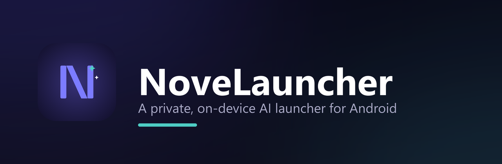
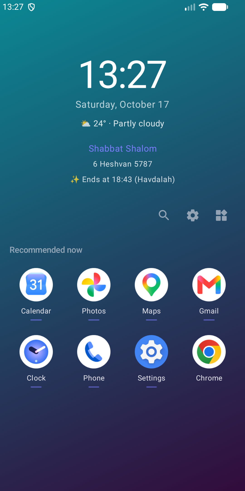
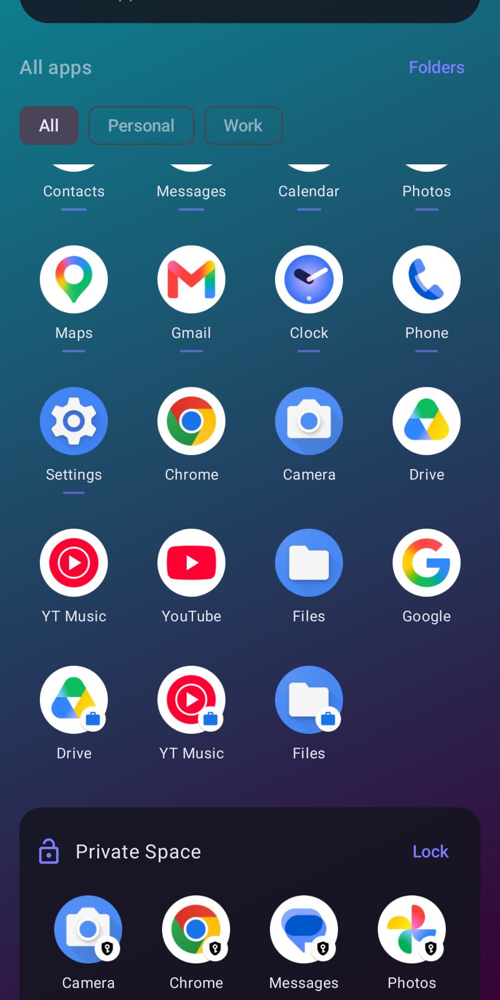
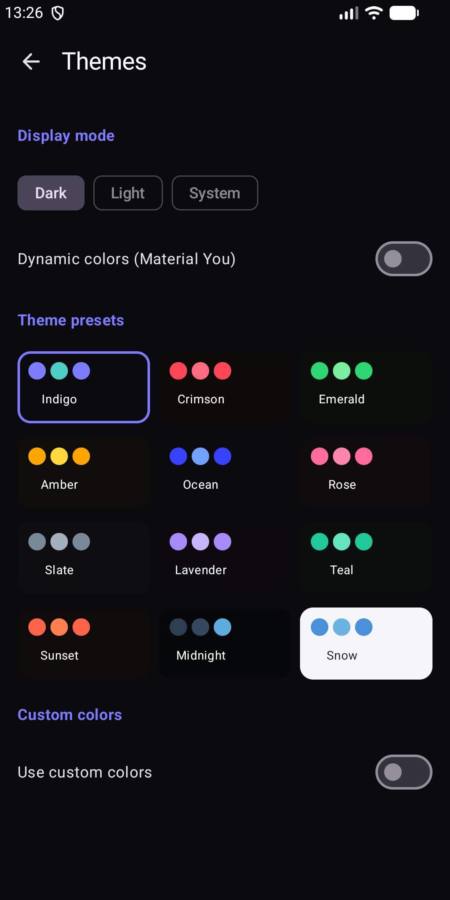
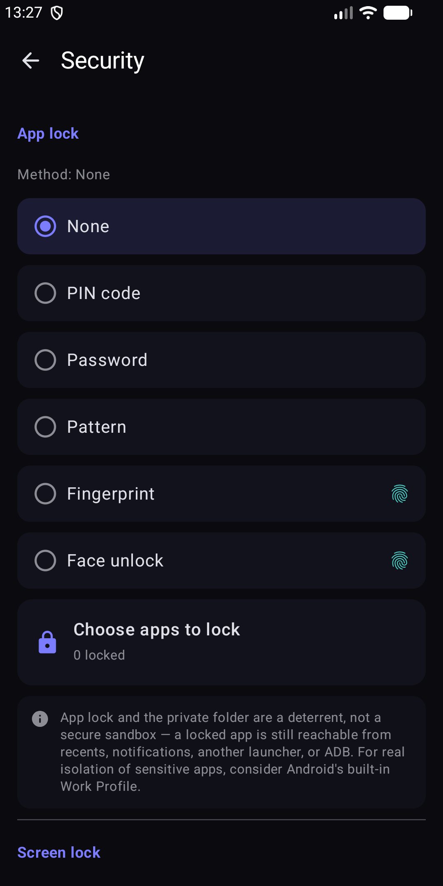

<div align="center">



<br>

**Лаунчер для Android, который изучает ваши привычки — и никуда их не отправляет.**

[](https://github.com/DrummingBird1/NoveLauncher/releases/latest)
[](#системные-требования)
[](https://kotlinlang.org)

[**Сайт**](https://drummingbird1.github.io/NoveLauncher/) ·
[**Скачать**](https://github.com/DrummingBird1/NoveLauncher/releases/latest) ·
[**Конфиденциальность**](https://drummingbird1.github.io/NoveLauncher/privacy.html) ·
[**История изменений**](../../CHANGELOG.md) ·
[**Участие в проекте**](../../CONTRIBUTING.md)

**Другие языки:**
[English](../../README.md) ·
[עברית](README.he.md) ·
[العربية](README.ar.md) ·
[Français](README.fr.md) ·
[Español](README.es.md) ·
[Deutsch](README.de.md)

</div>

---

## Что это

NoveLauncher заменяет домашний экран Android. Он ранжирует и группирует ваши
приложения по реальному использованию — что вы открываете, когда и как часто —
чтобы нужное уже было перед глазами.

Ранжирование выполняется **полностью на вашем устройстве**. Без аккаунта, без
сервера, без аналитики, без рекламы. Данные об использовании никогда не
покидают телефон.

## Возможности

| | |
|---|---|
| 🧠 **Обучаемые подсказки** | Приложения ранжируются по давности, частоте, времени суток и категории; блок «Рекомендации» также учится на том, какие подсказки вы действительно открываете — всё считается локально |
| 📁 **Умные папки** | Автоматическая группировка по 11 категориям, без ручной сортировки |
| 💼 **Рабочий профиль и Личное пространство** | Рабочие приложения с отметкой профиля и переключателем паузы; Личное пространство Android 15 — в отдельном разделе с блокировкой, никогда не смешивается с подсказками и скрыто из поиска, пока заблокировано |
| ⚡ **Ярлыки приложений** | Долгое нажатие на приложение открывает его ярлыки — новое сообщение, сохранённый маршрут — прямо с главного экрана |
| 🔍 **Умный поиск** | Приложения, контакты и настройки из одной строки. Сопоставление иврита и латиницы («וואטסאפ» находит WhatsApp), устойчивость к опечаткам и поиск по первым буквам («gm» → Google Maps), а также калькулятор и перевод единиц |
| 🕯️ **Еврейский календарь и субботний режим** | Дата по еврейскому календарю, праздники (израильский календарь или календарь диаспоры), время зажигания свечей и Авдалы — всё рассчитывается на телефоне; субботний режим скрывает отвлекающие подсказки и значки уведомлений от зажигания свечей до наступления ночи |
| 🖼️ **Обои** | Ваши фото или встроенные градиенты — одни на всё, для каждой страницы, по часам, по дням недели или системные (в том числе живые) обои — с яркостью, контрастом, насыщенностью, теплотой, размытием и виньеткой |
| 👆 **Жесты** | Свайп вверх — приложения, свайп вниз — уведомления, двойное касание — выключить экран |
| 🎨 **Глубокая настройка** | 12 цветовых пресетов, Material You, свои цвета, 16 шрифтов, 12 форм значков |
| 🧷 **Иконпаки** | Любой иконпак, совместимый с Nova / ADW / Lawnchair; приложения, которых нет в наборе, сохраняют свой значок |
| 🔒 **Блокировка приложений** | PIN, пароль, графический ключ или биометрия для отдельных приложений, приватная папка и скрытые приложения |
| 🌍 **7 языков** | Иврит, английский, арабский, французский, русский, испанский, немецкий — с полной поддержкой RTL |
| 📰 **Лента новостей** | Встроенные источники и ваши собственные RSS-ленты |
| 💾 **Резервные копии** | Локально или на вашем NAS/WebDAV, по расписанию, с опциональным шифрованием паролем |
| 📊 **Статистика использования** | Экранное время и использование приложений за день, неделю или месяц — данные Android, прямо на устройстве |
| 🧩 **Виджеты и док** | Стандартные виджеты Android (с экранами настройки, высотой от 1 до 4 рядов) и нижний док до 5 закреплённых приложений |

## Скриншоты

<div align="center">






</div>

## Конфиденциальность

Это смысл всего проекта, поэтому стоит быть точным:

- **Ничего не собирается.** Ни аналитики, ни телеметрии, ни отчётов о сбоях в
  распространяемых сборках, ни аккаунта, ни рекламы.
- **Данные об использовании остаются локальными.** Сведения об использовании
  приложений берутся из статистики Android и обрабатываются на устройстве; то,
  чему учатся подсказки, хранится в локальной базе данных. Ничего из этого не
  выгружается.
- **Сеть используют только четыре функции — и больше ничего:**
  - **Погода** — запрашивает текущую погоду у
    [Open-Meteo](https://open-meteo.com). Примерные координаты отправляются,
    только если вы выдали разрешение на геолокацию; без него запрашивается
    погода для города по умолчанию.
  - **Новости** — страница новостей загружает включённые вами RSS-ленты
    напрямую с сайтов издателей.
  - **Резервные копии** — только если вы выбрали NAS: ваш собственный сервер,
    по HTTPS.
  - **Проверка обновлений** — по умолчанию выключена. Если её включить,
    приложение не чаще раза в день спрашивает у API релизов GitHub, какая
    версия последняя. Никаких данных о вас или устройстве не отправляется, и
    ничего не скачивается автоматически.

  Всё остальное остаётся на устройстве.
- **Резервные копии — ваши.** На телефоне или на вашем NAS, с шифрованием
  паролем, который знаете только вы.
- **Еврейский календарь считается на телефоне.** Время праздников, зажигания
  свечей и Авдалы рассчитывается по вашему примерному местоположению, если вы
  это разрешили (иначе — по городу по умолчанию), и никуда не отправляется.
- **Помощник жестов ничего не читает.** Двойное касание для выключения экрана
  работает через необязательную службу специальных возможностей, которая
  выполняет ровно два действия (выключить экран, открыть уведомления) и не видит
  содержимое экрана.

Подробнее: [**Политика конфиденциальности**](https://drummingbird1.github.io/NoveLauncher/privacy.html) ·
[Условия использования](https://drummingbird1.github.io/NoveLauncher/terms.html)

> **О блокировке приложений:** блокировка, приватная папка и скрытые
> приложения — это **сдерживающая мера, а не безопасная песочница**.
> «Заблокированное» приложение всё ещё доступно через недавние приложения,
> уведомления, другой лаунчер или ADB — это верно для любого стороннего
> лаунчера. Для настоящей изоляции используйте встроенный рабочий профиль Android
> или Личное пространство (Android 15+) — NoveLauncher поддерживает оба.

## Загрузка

Скачайте подписанный APK из [**последнего релиза**](https://github.com/DrummingBird1/NoveLauncher/releases/latest).

Потребуется разрешить установку из неизвестных источников. Все релизы
подписаны одним ключом, поэтому обновления устанавливаются поверх друг друга
без проблем.

<a href="https://github.com/ImranR98/Obtainium"></a>

**Автоматические обновления:** [Obtainium](https://github.com/ImranR98/Obtainium) устанавливает NoveLauncher
прямо из этих релизов на GitHub и обновляет его. В Obtainium добавьте приложение
и вставьте `https://github.com/DrummingBird1/NoveLauncher`.

### Системные требования

- Android 8.0 (API 26) или новее
- около 25 МБ свободного места

Некоторым функциям нужно больше: Личному пространству — Android 15, двойному
касанию для выключения экрана — Android 9. Личное пространство, ярлыки
приложений и пауза рабочих приложений работают, только когда NoveLauncher выбран
главным экраном по умолчанию.

## Сборка из исходников

```bash
git clone https://github.com/DrummingBird1/NoveLauncher.git
cd NoveLauncher/android
./gradlew assembleDebug
```

Откройте папку **`android/`** в версии Android Studio с поддержкой Android
Gradle Plugin 9.4 — не корень репозитория, который не является проектом Gradle.
Для Gradle нужен **JDK 21** (укажите его как Gradle JDK в Android Studio); само
приложение компилируется в байт-код Java 17.

## Участие в проекте

Issues и pull requests приветствуются — см.
[CONTRIBUTING.md](../../CONTRIBUTING.md). По вопросам безопасности сначала
прочитайте [SECURITY.md](../../SECURITY.md) и сообщайте приватно.

## Поддержать проект

NoveLauncher бесплатен, без рекламы и встроенных покупок. Если хотите
поддержать разработку:

<div align="center">

[](https://www.patreon.com/c/Solvaris)
[](https://buymeacoffee.com/solvaris)

</div>

## Контакты

Вопросы, ошибки или предложения: **solvaris2@gmail.com** или
[создайте issue](https://github.com/DrummingBird1/NoveLauncher/issues).

## Лицензия

См. [LICENSE](../../LICENSE). Исходный код опубликован для прозрачности и
аудита — он не распространяется под лицензией с открытым исходным кодом.
